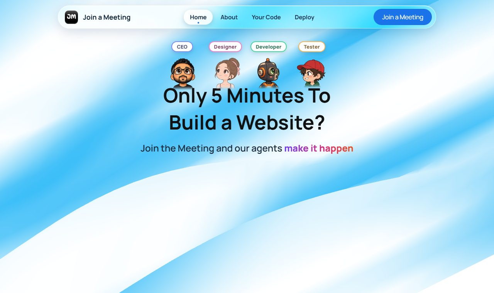
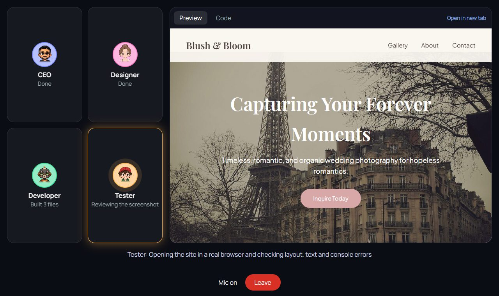
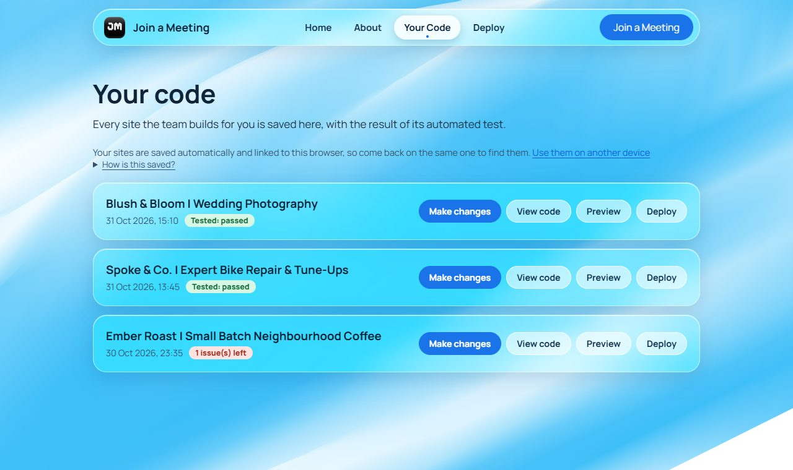
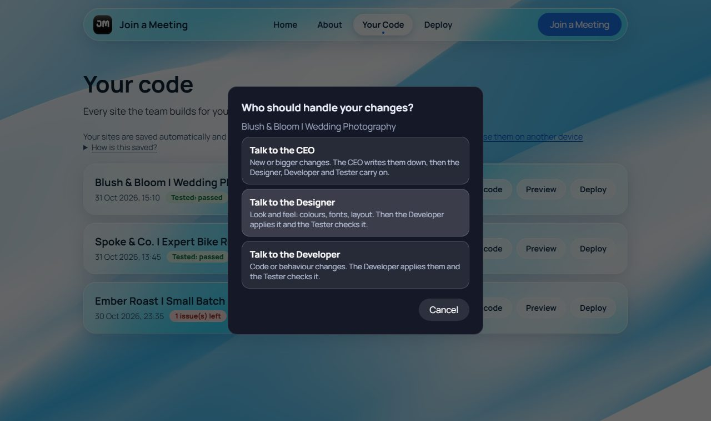
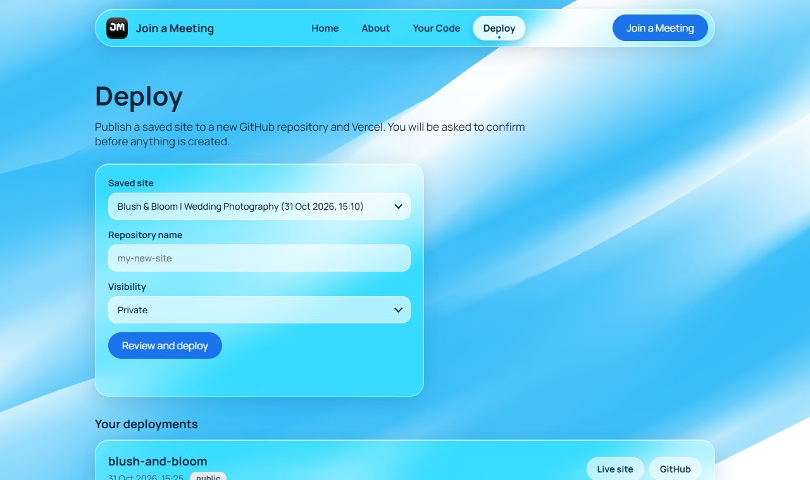
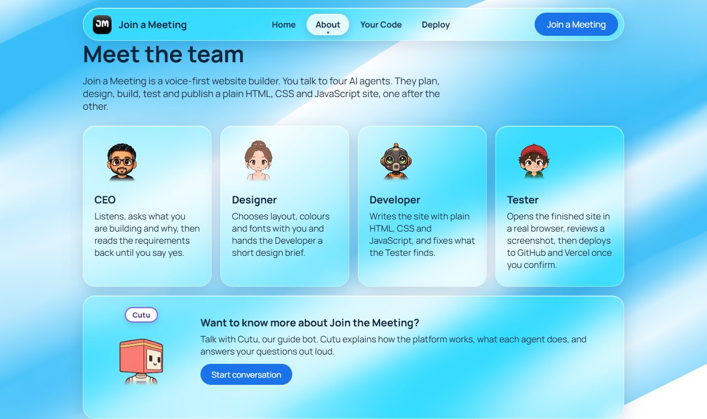
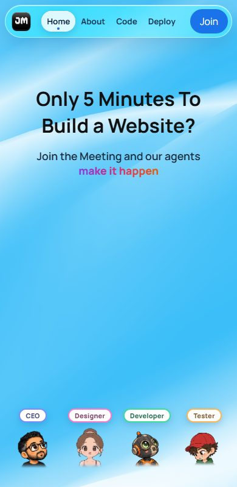
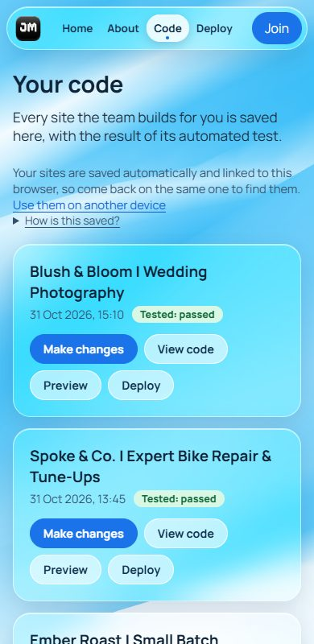
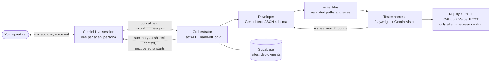

<p align="center">
  
</p>

<h1 align="center">Join the Meeting</h1>

<p align="center">
  <b>Say your idea out loud. A team of four AI agents plans, designs, builds and tests your website,<br>
  then pushes it to GitHub and deploys it on Vercel.</b>
</p>

<p align="center">
  
  
  
  
  
  
</p>



## What it is

**Join the Meeting** is a multi-agent website builder you talk to. You press *Join a Meeting*, allow the microphone, and have a
real **voice-to-voice** conversation with an AI team. Each agent has its own **persona, voice and job**, and they hand the work to
each other like a real team. When the site is built, a **tool harness** opens it in a real browser, checks it, and, only after you
confirm on screen, pushes the code to GitHub and deploys it on Vercel.

Later you can come back to **Your Code**, pick any saved site, choose *who* you want to talk to (CEO, Designer or Developer), and
have the same team change it and push the update to the **same repository**.

## How a meeting goes

| | Agent | Character | What they do |
|---|---|---|---|
| 1 | **CEO** | Kamran | Asks what you want to build and why, reads the requirements back, waits for your "yes". |
| 2 | **Designer** | Ballerina | Asks about mood, colours, fonts and sections, then summarises the design. |
| 3 | **Developer** | Scout | Asks about the stack (plain HTML, CSS and JavaScript for now) and builds the site. |
| 4 | **Tester** | Cap | Opens the site in a real browser, reviews a screenshot, has the Developer fix problems (up to 2 rounds), then offers to deploy. |
| + | **Cutu** | Cube | A separate guide bot on the About page that explains the platform out loud, and stays strictly on topic. |

## Features

- **Voice-to-voice agents.** Four personas, each with its own voice, personality and tools, talking in real time over Gemini Live.
- **Orchestration.** Agents hand over through function calls. When you approve a summary, the agent calls a tool, and the
  orchestrator passes that summary on as shared context and starts the next persona.
- **AI tool harness.** The tools that touch the outside world are small, validated and guarded (see below). No screen-control, only official APIs.
- **Real browser testing.** Playwright opens the generated site, scrolls it, collects console errors and takes a screenshot; Gemini
  vision reviews it against the brief; the Developer fixes what is found. It stops after two rounds and reports honestly if issues remain.
- **Make changes.** From *Your Code*, choose the CEO, Designer or Developer. The team continues down the line, updates the **same site**,
  re-tests it, and the Tester can push **one commit to the existing repo** and redeploy the same Vercel project.
- **Your Code and Deploy pages.** Every site and deployment is saved to Supabase. View code, preview, change, deploy, redeploy.
- **Workspace key.** No accounts: your sites are tied to your browser, and a copy-and-paste key carries them to another browser or device.
- **Live progress.** Every step streams to the tiles as it happens, so you can see who is working and what they are doing.
- **Polished, responsive UI.** Glassmorphism, animated mascots, a WebGL background, and layouts checked from 320 px to 1280 px.

## Screenshots

| Meeting room, mid-build | Your Code |
|---|---|
|  |  |
| **Make changes: choose who to talk to** | **Deploy** |
|  |  |
| **Cutu, the guide bot** | **On a phone** |
|  |   |

## Architecture



**Voice is not a stitched STT → LLM → TTS pipeline.** Each agent runs on Gemini's native-audio Live model over a WebSocket: it hears
you and speaks back directly, which keeps latency low and lets you interrupt. Transcripts of both sides come back alongside the audio
and are used for captions and for the context passed between agents.

**Personas are locked on the server.** The backend mints a short-lived, single-use token whose constraints contain the persona's
prompt, voice and tools, so the browser never sees the real API key and cannot change who it is talking to.

**Hand-offs are tool calls.** `confirm_requirements`, `confirm_design`, `confirm_stack` and friends end an agent's turn. Their summaries
are the only thing passed forward, and the orchestrator waits for the farewell audio to finish before switching agents.

### The tool harness

| Tool | What it does | Guard rails |
|---|---|---|
| `write_files` | Writes the Developer's output to disk | Allow-list of extensions, no `..` or absolute paths, 20 files, 200 KB each, `index.html` required |
| `run_playwright_check` | Opens the site in Chromium, scrolls, screenshots, collects console errors | Skips cleanly where no browser exists (e.g. Vercel) and reports the site as *not tested*, never as passed |
| `github_push` | Creates a repo, or updates an existing one as **one fast-forward commit** | Never overwrites an existing repo, never force-pushes, validates repo names |
| `vercel_deploy` | Uploads the files straight to Vercel and waits until ready | Same project name each time, so a redeploy updates the same site |

Everything that creates or changes something outside the app needs the user's click on an on-screen confirm card.

### Data

Two Supabase tables, locked with row-level security so only the backend's service key can touch them (see [`supabase/schema.sql`](supabase/schema.sql)):
`sites` (files, title, brief, test result, rounds) and `deployments` (repo, live URL, visibility).

### API

| Method | Path | Purpose |
|---|---|---|
| `GET` | `/api/health` | What is configured (never any values) |
| `POST` | `/api/token` | Mint a persona-locked ephemeral Live token |
| `POST` | `/api/build` | Build or revise a site, streamed as server-sent events |
| `POST` | `/api/deploy` / `/api/redeploy` | First deployment / push changes to the existing repo (both need `confirmed: true`) |
| `GET` | `/api/sites`, `/api/sites/{id}`, `/api/deployments` | Your saved work, scoped to your workspace |
| `GET` | `/sites/{id}/` | The generated site, served with a strict Content-Security-Policy |

## Tech stack

| Layer | Technology | Why |
|---|---|---|
| Voice and agent brains | **Google Gemini Live API** (native audio), **Gemini** text and vision models | Real-time voice-to-voice, JSON-schema output, function calling |
| Backend | **Python, FastAPI** | Native ASGI, streams progress live, deploys on Vercel without an adapter |
| Orchestration | Our own small loop | Deterministic and testable; a framework added latency and nothing we needed (see [`SPIKE_REPORT.md`](SPIKE_REPORT.md)) |
| Testing harness | **Playwright** + Gemini vision | The agent actually looks at the page |
| Database | **Supabase** (Postgres) over its REST API | Saves sites and deployments, no extra SDK |
| Deploy | **GitHub REST API**, **Vercel REST API** via `httpx` | Official APIs instead of fragile UI automation |
| Frontend | Plain **HTML, CSS and JavaScript** | No build step; glassmorphism, WebGL, animated mascots |
| Quality | **pytest** (100+ tests), real-browser and real-agent end-to-end runs | |

Libraries, fonts and artwork are credited with their licenses in [`THIRD_PARTY.md`](THIRD_PARTY.md).

## Quick start

You need **Python 3.11+**, a **Gemini API key**, and a free **Supabase** project. A GitHub token and a Vercel token are optional and
only needed for deploying from the app.

```bash
git clone https://github.com/amanyatan/HACKTOBERERFEST-BHOPAL-JOIN-THE-MEETING.git
cd HACKTOBERERFEST-BHOPAL-JOIN-THE-MEETING

python -m venv backend/.venv
# Windows:        backend\.venv\Scripts\activate
# macOS / Linux:  source backend/.venv/bin/activate
pip install -r backend/requirements.txt
python -m playwright install chromium

cp backend/.env.example backend/.env      # Windows PowerShell: copy backend.env.example backend.env  (then fill in the values below)
python -m uvicorn main:app --app-dir backend --port 8000
```

Then open **http://localhost:8000**. Run the contents of [`supabase/schema.sql`](supabase/schema.sql) once in the Supabase SQL editor
to create the two tables.

| Variable (`backend/.env`) | Needed | For |
|---|---|---|
| `GEMINI_API_KEY` | yes | The voice agents, Developer and Tester |
| `SUPABASE_URL`, `SUPABASE_SERVICE_KEY` | yes | Saving sites and deployments (the service key stays on the server) |
| `GEMINI_API_KEY_BOT` | optional | Cutu, the guide bot, uses its own key |
| `GITHUB_TOKEN` | optional | Deploying: a classic token with the `repo` scope |
| `DEPLOY_VERCEL_TOKEN` | optional | Deploying (an older `VERCEL_TOKEN` line still works locally) |
| `LIVE_MODEL`, `TEXT_MODEL`, `FALLBACK_MODEL`, `THINKING_LEVEL` | optional | Model tuning, the defaults are fine |

No editor handy for a secret? `python scripts/set_env.py GEMINI_API_KEY` asks for the value with hidden input and updates just that line.

```bash
python -m pytest backend        # the whole test suite
```

## Try it in 60 seconds

1. Press **Join a Meeting** and allow the microphone. Use headphones, or the agents will hear themselves.
2. Tell the CEO one sentence: *"A website for my bike repair shop with services and a contact form."*
3. Answer a few short questions, say **"yes"** when each agent reads its summary back, and watch the tiles light up.
4. The preview appears beside the meeting. Open **Tester's view** to see the screenshot it reviewed.
5. Go to **Your Code**, press **Make changes**, pick the Designer and say *"make the heading red"*.

No microphone? In the browser console, `sendText("your sentence")` talks to whichever agent is listening.

## Security

- The real API key never reaches the browser: only short-lived, single-use tokens with the persona locked inside.
- Generated sites are untrusted: they are served from a separate path with a strict CSP and shown in a sandboxed iframe.
- Every file path and size from model output is validated before anything is written.
- Deploying and redeploying need an explicit on-screen confirmation, and the server refuses requests without it.
- Per-endpoint rate limits; row-level security on the database; the public anon key can read and write nothing.
- Secrets live only in `backend/.env` (git-ignored) or in Vercel's environment; every push is scanned first.

## Project layout

```
app.py                    Vercel entrypoint (re-exports the FastAPI app)
vercel.json, requirements.txt, .python-version, .vercelignore
backend/
  main.py                 FastAPI app: routes, rate limits, streaming, site serving
  personas.py             Every agent's persona, voice and tools (plus revision personas and Cutu)
  orchestrator.py         Build -> test -> fix loop, emitting live events
  deploy_flow.py          First deployment and redeploy flows
  db.py                   Supabase over REST
  agents/                 developer.py, tester.py
  tools/                  write_files, run_playwright_check, github_push, vercel_deploy
  tests/                  pytest suite
public/                   The website: index.html, app.js, live.js, mascot.js, gradient-wave.js, style.css, mascots/
supabase/schema.sql       The two tables and their security
scripts/                  push_env_to_vercel.py, set_env.py
docs/screenshots/         Images used in this README
```

## Deploying to Vercel

The whole app deploys as one Vercel project: the website from the CDN, the API as one Python function. Setup, the environment
variable table and a post-deploy checklist are in [`DEPLOYMENT.md`](DEPLOYMENT.md). Two things to know: Vercel's name rules mean the token is
called `DEPLOY_VERCEL_TOKEN` there, and serverless cannot run Chromium, so sites built on Vercel are marked *not tested*.

## Honest notes and known limits

- **"5 minutes" is a goal, not a promise.** In our runs a full conversation plus build and test took roughly 4 to 6 minutes.
- Sites are **plain HTML, CSS and JavaScript** for now.
- **Redeploying adds and updates files in the repo, but does not delete files** that a new version no longer has (Vercel always gets the exact set).
- There are **no accounts**: your workspace is tied to the browser. Use the workspace key on *Your Code* to move it.
- A generated site that uses `localStorage` may log errors inside the sandboxed preview; it works once deployed.
- Voice needs a microphone and HTTPS or `localhost`. The glass dropdown styling needs Chrome or Edge 135+; other browsers keep their normal dropdowns.
- On Vercel, rate limits are per function instance, so they are a soft limit.

## Roadmap

ZIP download · more stacks than plain HTML/CSS/JS · the Designer opening a reference website on a shared screen · deleting removed files on redeploy ·
accounts and a shared rate-limit store · more characters and voices.

## Credits and license

Built with Google Gemini, FastAPI, Playwright, Supabase and Vercel; characters from [page-mascot](https://github.com/nilbuild/page-mascot)
by Kamran Ahmed (MIT). Full list and licenses: [`THIRD_PARTY.md`](THIRD_PARTY.md).

This repository does not have a license file yet, so by default all rights are reserved by the authors. Add a `LICENSE` before anyone reuses the code.
